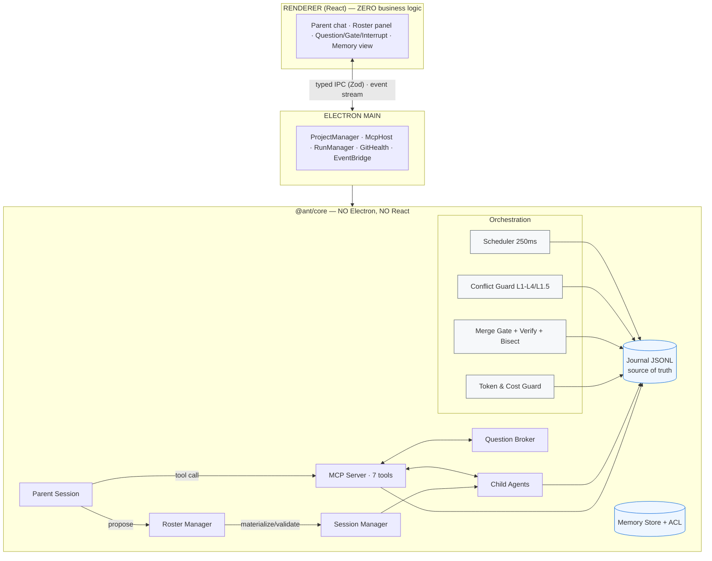
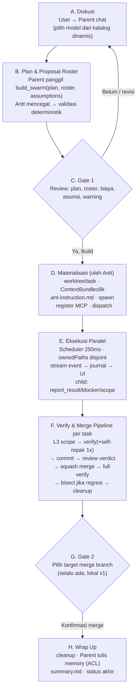
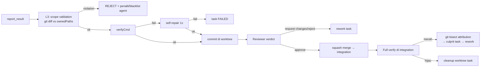
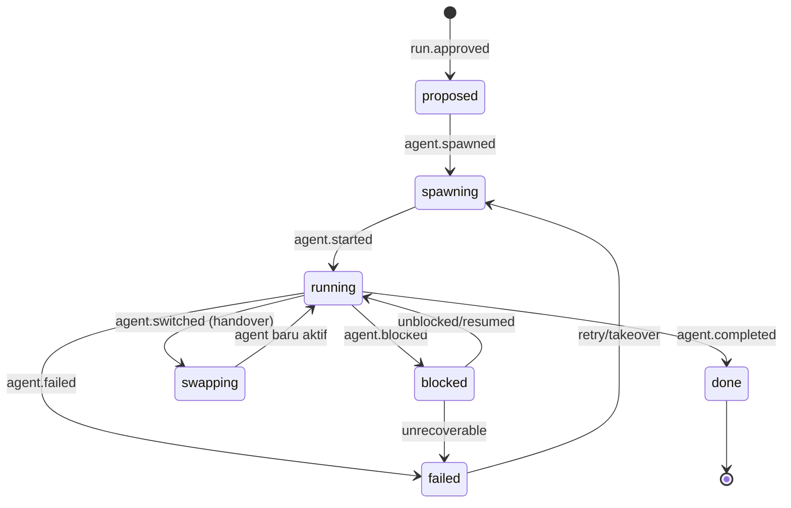
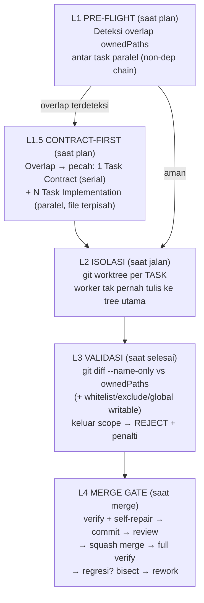
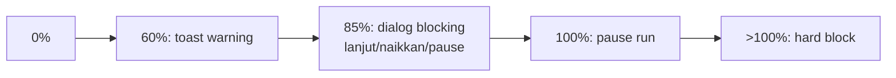

# Jurnal Teknis Antt — Penjelasan Proyek dari Awal sampai Akhir

> **Satu berkas, satu cerita utuh.**  
> Dokumen ini ditulis sebagai jurnal teknis: mengikuti alur bagaimana Antt dipikirkan, bagaimana ia bekerja saat dijalankan, dan bagaimana setiap keputusan arsitektur saling mengunci. Bukan daftar bab kaku, melainkan penelusuran dari masalah → prinsip → mekanisme → data → pengalaman pengguna.
>
> **Tagline:** *Deal with the Queen. Delegate to the swarm.*  
> **Status desain:** arsitektur v1.0 terkunci (2026-10-03, 55 ADR, 1 superseded) · **implementasi:** belum produksi penuh (PRD, TECH-SPEC, UI-SPEC, prototipe `development/anttv1`)  
> **Sumber rujukan:** `/Volumes/Adyfas/Project/Ant/PRD.md`, `docs/UI-SPEC.md`, `docs/architecture/TECH-SPEC.md`, dan vault `Project-Antt/` (`19 Architecture Overview`, `06 Conflict Guard & Merge Gate`, `21 MCP Protocol Layer`, `20/22/23/24/25`, `09 Data Model`, dst.)

---

## Catatan 0 — Premis: Antt itu Apa (dan Bukan Apa)

Ketika saya pertama kali memahami Antt, hal paling penting bukan daftar fiturnya, melainkan **identitasnya**:

- Antt adalah **aplikasi desktop GUI** (Electron + React) untuk membangun perangkat lunak dengan **parallel agent swarm**.
- Antt **tidak punya model AI sendiri**. Ia memakai agent/provider yang **sudah dimiliki user**: opencode, Kilo Code, Qwen, Cline, Claude Code, atau API key sendiri (OpenAI/Anthropic/OpenRouter/Ollama/endpoint OpenAI-compatible).
- Antt **bukan terminal emulator** dan **tidak “paste ke CLI”**. Antt melakukan *dispatch* instruksi terstruktur ke proses agent lewat ACP (JSON-RPC), HTTP API, atau tool-call (PTY hanya fallback khusus). Bedanya krusial: ini pengiriman job terstruktur, bukan simulasi ketikan manusia.

Tiga janji produk yang membedakan Antt dari “sekadar menjalankan banyak agent”:

1. **Parent merancang tim, bukan cuma rencana.** Parent (model yang dipilih user) memberi nama agent sesuai spesialisasi, memilih backend & model per agent, menulis instruksi. User meninjau tim sebelum build.
2. **“Dibagi rata” dijamin algoritma.** Tiap task punya tepat 1 owner; beban tiap agent harus dalam **0.7×–1.4× rata-rata** (bobot kompleksitas). Tidak valid → rebalance / eskalasi.
3. **Konflik dicegah secara fisik.** Bukan berharap agent disiplin: tiap task dapat **git worktree terpisah**, plus validasi kepemilikan path, perencanaan contract-first, validasi scope pasca-kerja, dan merge gate.

Estimasi realistis (1 run, 5 task, 3 agent, 30 menit paralel): ~**2.5×** lebih cepat vs sekuensial, ~**55%** token lebih efisien (420k → ~185k) lewat bundling/konteks terkontrol, target **0 konflik kode**, waktu user turun drastis (monitoring → review). Target: **MVP (loop tertutup) minggu 15**, **v1.0 minggu 21**.

---

## Catatan 1 — Akar Masalah: Mengapa Swarm Naif Selalu Gagal

Jurnal ini mulai dari rasa sakit yang nyata. Pola developer yang memakai AI CLI secara manual biasanya berakhir begini: satu sesi mengerjakan task besar → konteks jenuh dan lupa kontrak awal; dibuka banyak window untuk paralel → dua agent mengedit file yang sama → konflik git; waktu habis merapikan, bukan membangun.

Peta masalah → jawaban Antt (inti yang saya pegang saat menelusuri desain):

| Masalah | Akar | Jawaban Antt (mekanisme) |
|---|---|---|
| P1 Context meledak | Konteks monolitik | **Context Bundling** per task, hard cap **8k token** |
| P2 Konflik kode | Working tree bersama | **5 lapis guard** (L1, L1.5, L2, L3, L4) — isolasi fisik + validasi |
| P3 Pembagian timpang | First-come-first-serve | **Roster validation** + balancing 0.7–1.4× |
| P4 Quota habis | Single provider | **Health tracking + fallback/switch + handover** |
| P5 “Done” palsu | Tak ada verifikasi wajib | **Verify gate + reviewer verdict + merge gate** |
| P6 Regresi misterius | Tak ada jejak | **Journal event + git bisect attribution** |
| P7 Crash = kerja hilang | State di memori | **Checkpointed state dari journal** (source of truth) |
| P8 Black box | Keputusan tak tercatat | **Audit trail** (prompt, diff, verdict, biaya, asumsi) |
| P9 Tak ada konvensi agent | Tiap CLI beda | **1 MCP server, 7 tools**, kontrak seragam |

Mengapa pendekatan lain ditolak (insight penting): framework multi-agent berbagi tree (CrewAI/AutoGen/LangGraph) gagal karena **tak ada isolasi fisik** → konflik dijamin; tmux+script tak punya DAG/review/audit; container per agent overhead besar padahal worktree memberi isolasi file dengan overhead ~0; satu agent prompt panjang tetap kalah oleh batas konteks (P1).

---

## Catatan 2 — Aturan Emas dan Peta Besar Sistem

Sebelum masuk ke alur, ada satu kalimat yang mengunci seluruh arsitektur:

> **Parent menentukan APA. Antt menentukan BAGAIMANA dan MENGAPA BOLEH.**

Ini bukan gaya bahasa, tapi batas otoritas yang keras:

- **Parent (model)**: berdiskusi, menyusun plan, mengusulkan roster & asumsi. Ia **tidak pernah** menulis perintah shell, menentukan `cwd`, menentukan `ownedPaths` final, spawn proses, atau menjalankan git/verify/merge.
- **Antt (sistem/core)**: memvalidasi, mematerialisasi worktree, spawn, dispatch, menjaga guard, menjalankan verify, mengelola merge — selalu dengan gate manusia pada titik kritis.
- **Alasan keamanan & kebenaran**: bila Parent bisa menyusun shell/`cwd`/`ownedPaths`, prompt injection di repo bisa lolos, isolasi worktree bisa dibolongi, dan validasi bisa dilewati. Aturan Antt *hardcoded*, tak bisa ditulis ulang model.

Tujuh prinsip arsitektur yang saya temukan konsisten di semua dokumen:

1. Otoritas terpisah (Parent usul, Antt eksekusi, Sistem mewujudkan).  
2. **State = journal event** → `RosterState/RunState/ringkasan = fold(events)`.  
3. **Tidak ada fallback diam-diam** → setiap degradasi/switch jadi event terlihat.  
4. **Tidak ada kejutan tagihan** → budget guard bertangga, eskalasi butuh izin.  
5. **Isolasi fisik > disiplin** → git worktree.  
6. **Context minimal tapi lengkap** → bundle cap 8k.  
7. **UI hanya render** dari event stream; nol logika bisnis di renderer.

### Peta komponen (cara saya membayangkan “tubuh” Antt)



**Boundary keras (ditegakkan, mis. dependency-cruiser/kontrak):** `@ant/core` tidak boleh import `electron`/`react`; semua boundary IPC/API divalidasi Zod dua sisi; renderer tidak spawn/git/agent langsung dan tidak menghitung ulang metrik bisnis (cost/token/context) — ia hanya merender dari journal/event.

**Tech stack (pilihan sadar):** Node 20+ (desktop) + Bun dev/test, TypeScript strict, Electron 3x + electron-vite, React 19/Tailwind v4/Zustand, transport agent **ACP (JSON-RPC stdio)** + node-pty fallback, `@modelcontextprotocol/sdk`, `simple-git`, Vercel AI SDK (API-direct), Zod v3, storage **Git + Markdown + JSONL (tanpa DB)**, Vitest + Playwright, electron-builder. Deliverable v1: **satu desktop app GUI** (tanpa CLI/headless runner, tanpa terminal view xterm, tanpa push/PR otomatis).

---

## Catatan 3 — Perjalanan Satu Run: Dari Chat ke Merge (Fase A–H)

Ini bagian yang paling “jurnal”: membayangkan satu sesi nyata dari detik pertama aplikasi dibuka sampai hasilnya menyatu kembali.

### Alur besar (narasi + peta)



Sekarang saya telusuri tiap fase secara teknis.

### Fase A — Diskusi (Parent Chat)
- User langsung masuk chat Parent dan memilih model dari **katalog dinamis** (provider/agent yang tersedia, lengkap harga/context/capability). Bukan hardcode.
- Parent multi-turn: klarifikasi kebutuhan, menggali constraint. Pertanyaan ke user (bila perlu) lewat mekanisme terstruktur (lihat Catatan 6), bukan tebakan diam-diam.
- Model tanpa tool-calling untuk mode yang bergantung tool **diblokir** (bukan degraded diam-diam) — kejujuran kemampuan lebih penting daripada ilusi berjalan.

### Fase B — `build_swarm` dicegat, lalu divalidasi mesin
Parent, saat siap, memanggil tool **`build_swarm({ plan, roster, assumptions })` sekali**. Antt **tidak langsung eksekusi** — ia mencegat dan menjalankan rantai validasi deterministik (LLM merancang, algoritma memvalidasi):

1. **Plan validator:** tak ada cycle deps, tak ada missing deps, `ownedPaths` tidak kosong, `acceptance` tidak kosong, path valid (tanpa `..`).
2. **L1 pre-flight:** deteksi overlap `ownedPaths` antar task paralel yang tak punya dependency chain.
3. **Roster validator:** tiap task **tepat 1 owner**, beban 0.7–1.4×, backend/model tersedia & tool-calling, nama unik/valid, skill cocok (warning bila meleset).
4. **Capacity check:** `swarmSize <= maxConcurrency` (warning antre bila lebih).
5. **Budget projection:** estimasi biaya low–high (bobot task, harga model nyata, buffer rework).
6. **Git preflight L0 (7 cek, wajib lolos):** gagal → `blocked_on_setup` (lihat Catatan 5/Git).

Hasil: **rejected** + daftar error terstruktur (Parent boleh perbaiki, maks 2×) atau **needs_confirmation** → Gate 1 dirender. `assumptions` wajib diisi (asumsi tak dicatat = keputusan diam-diam).

### Fase C — Gate 1 (manusia memegang kendali)
Gate 1 menampilkan: ringkasan plan, roster (nama/role/backend/model/task), estimasi biaya per agent & total, status validasi (balanced, backend tersedia, path tak konflik), asumsi Parent, dan warning (mis. model mahal untuk task sederhana). Aksi user: **Ya, Build / Belum / Ganti-Minta Roster Baru / Lihat & Edit Instruksi**. 
Catatan penting: edit **prose** instruksi tak memicu revalidasi penuh; edit **batas** (`ownedPaths`, `verifyCmd`, `readPaths`) **wajib revalidasi penuh**; **footer keamanan** (aturan guard/tool) **tidak bisa diedit** — selalu disuntik Antt.

### Fase D — Materialisasi (kerja “tangan” Antt)
Setelah `approved`, Antt — bukan model — mengeksekusi: (1) buat run + **git worktree per task**, (2) susun **ContextBundle** per task (system prompt, task card+acceptance, ownedPaths ter-resolve, konvensi repo, top-K memory/BM25, ringkasan deps selesai) dengan **hard cap 8k token** (over budget setelah trimming → task ditolak jelas, bukan dikirim pasti gagal), (3) tulis `.ant-instruction.md` = [bagian editable] + [footer terjamin], (4) spawn proses child per task/session, (5) daftarkan MCP server bila perlu, (6) dispatch instruksi (ACP/HTTP/API-direct; PTY fallback).

### Fase E — Eksekusi paralel (terkendali)
- **Scheduler tick 250ms**: lepas agent selesai, hitung slot, ambil task `ready` (deps merged), utamakan critical path.
- **Aturan paralel keras:** dua *writer* task hanya boleh jalan bersamaan jika `ownedPaths` **disjoint**. Reader/writer diatur sesuai kebijakan path.
- **Kapasitas 1 task per agent** (paralelisme datang dari banyak agent, bukan multitasking satu proses).
- Child bekerja di worktree masing-masing; event streaming → journal → IPC → UI. Child **hanya boleh melapor** lewat `report_result`, `report_blocker`, `request_scope_extension` (tidak boleh `ask_user`). Interrupt/blocker memunculkan InterruptCard; run bisa `paused_waiting_user` (task baru berhenti dijadwalkan, task berjalan bisa lanjut sesuai kebijakan).

### Fase F — Verify & Merge pipeline (per task)
Saat `report_result`, Antt **tidak percaya klaim**: ia memvalidasi sendiri.



### Fase G — Gate 2 (merge target, selalu ditanya)
Antt enumerasi branch lokal, memberi ranking kandidat (default/develop/relevansi objektif/freshness, filter prefix internal `ant/`), lalu user memilih target. **Gate 2 selalu ada** meski hanya 1 branch (merge mahal dibatalkan). v1: **merge lokal saja**, tanpa push/PR otomatis — UI menampilkan perintah manual + peringatan branch protection.

### Fase H — Wrap up
Cleanup worktree/artefak sesuai policy; Parent menulis memory ke zona sesuai ACL; `summary.md` dibuat (durasi, biaya, speedup, incident, hasil task); status akhir ditampilkan.

---

## Catatan 4 — Anatomi Teknis: Komponen demi Komponen

Di catatan ini saya membedah “organ” utama Antt, karena alur A–H hanya masuk akal jika tiap organ dipahami.

### 4.1 Parent Agent & Kontrak Plan
Parent adalah satu-satunya penghubung dialog dengan user. Ia mengubah percakapan menjadi **plan JSON tervalidasi**. Setiap task wajib punya: `id`, `title`, `intent`, `ownedPaths` (wajib, tanpa `..`), `deps`, `acceptance` (wajib), opsional `verifyCmd`, `complexity`, `skills`. Validasi deterministik menolak cycle/missing dep/path invalid/field kosong/konflik paralel tak ter-resolve. Katalog model dinamis; tool-calling capability menentukan boleh/tidaknya dipakai.

### 4.2 Roster/Swarm: LLM Merancang, Algoritma Memvalidasi

**Otoritas tiga lapis:** Parent *mengusulkan* → Antt *memvalidasi, materialisasi, memonitor, mengubah state* → Sistem *menjalankan proses nyata*. Parent tak bisa menerapkan roster sendiri.

**Balancing (“dibagi rata” yang terukur):** bobot kompleksitas `{1:1, 2:2, 3:4, 4:7, 5:12}`; beban agent = Σ bobot task / kapasitas; **harus 0.7×–1.4× rata-rata**. Pelanggaran → rebalance (maks 2×) atau eskalasi user.

Validasi roster: tiap task tepat 1 owner; tiap agent ≥1 task (warning jika idle); skill/domain (warning); backend/model tersedia & tool-calling; nama unik & valid (auto-fix duplikat seperti `Atlas-2`, konvensi 3–16 huruf kapital awal, bukan brand/orang, mencerminkan spesialisasi); kapasitas vs `maxConcurrency`.

**Amendemen:** hanya saat run berjalan, **butuh persetujuan user**, maks **2× per run**, dan selalu memicu revalidasi penuh (balance/availability/konflik path) — memberi kelonggaran tanpa merusak jaminan.

**Event sourcing roster:** `RosterState = fold(journalEvents)`.



State live: `proposed | spawning | running | queued | blocked | swapping | done | failed`. Renderer membaca dari event/journal, tidak menghitung ulang.

### 4.3 MCP Protocol Layer: Satu Kontrak, Tujuh Pintu

Tujuan: orkestrasi tidak bergantung parsing ad-hoc per CLI. **1 server, 1 shared state, banyak agent**.

- **Transport utama:** HTTP lokal `http://127.0.0.1:<random-port>/mcp`, bearer token per-run, bind `127.0.0.1`, identifikasi sesi/header. **Fallback:** stdio shim → HTTP. **API-direct:** tool didaftarkan langsung ke LLM SDK (tanpa MCP) dengan schema sama.
- **4 dari 5 agent target mendukung ACP** (opencode, kilo, qwen, cline; claude-code headless/kontrak khusus) → satu adapter/profil dominan, bukan lima bespoke.

```mermaid
flowchart LR
    subgraph Agents
      OP[opencode]:::a
      KI[kilo]:::a
      QW[qwen]:::a
      CL[cline]:::a
      CC[claude-code\n(headless)]:::a
    end
    subgraph Antt
      S["MCP Server\n127.0.0.1:random\n1 state / bearer per-run"]
      BR[QuestionBroker]
      ORC[Orchestrator/Core]
    end
    OP & KI & QW & CL <-->|HTTP / ACP / shim| S
    CC -->|API-direct/tool schema| ORC
    S <--> BR
    S <--> ORC
    classDef a fill:#f6f8fa,stroke:#57606a;
```

**7 tools (dua ranah, dipisah tegas):**

| Ranah | Tool | Fungsi inti |
|---|---|---|
| Parent (4) | `ask_user` | minta keputusan user (blocking, card inline) |
| | `build_swarm` ★ | ajukan plan+roster untuk dibangun (gate manusia) |
| | `amend_roster` | ubah roster saat run berjalan (gate manusia, maks 2×) |
| | `submit_plan` | bagikan plan terstruktur tanpa build |
| Child (3) | `report_result` | lapor selesai → memicu L3 + verify oleh Antt |
| | `report_blocker` | lapor mentok/kebutuhan bantuan |
| | `request_scope_extension` | minta izin akses di luar `ownedPaths` |

**Policy kritis:** child **tidak boleh `ask_user`** (mencegah multi-card chaos & abuse); semua error/rejection jadi journal event; Antt selalu memvalidasi ulang klaim child. Dispatch: ACP `session/prompt`, HTTP terstruktur, API-direct tool loop, PTY stdin (terlemah, checkpoint heuristik).

**Klarifikasi credential (sering rancu):** Agent = eksekutor (opencode/kilo/…), Provider = pemegang key (OpenAI/Anthropic/…), Model = otak spesifik. Jika agent sudah punya auth sendiri, Antt **tak menyentuh key**; Antt simpan key hanya untuk custom/API-direct (keychain/safe storage). Custom OpenAI-compatible = escape hatch (tambah 1 provider → modelnya muncul).

### 4.4 Session & Message Model: Hidupnya Percakapan dan Pekerjaan

- **Parent session:** 1 per percakapan, panjang (plan/roster/keputusan). **Child session:** 1 per **(agent × task)** — bukan per agent — agar isolasi worktree & konteks tetap ketat.
- **Message Queue** satu pintu: jawaban user (tool result), pesan user ke child, system message, recovery. `InjectedMessage { role: user|system, origin: human|ant|parent|child, delivery: immediate|nextCheckpoint|nextTaskBoundary }`. Delivery bergantung state (`idle/running/blocked/done/spawning`) & mode.

**Checkpoint detection per transport:** ACP (tool call update completed), HTTP-SSE (part completed/session idle), API-direct (selesai 1 step/tool cycle), PTY (heuristik idle/prompt, konservatif).

**Aturan emas — Chat ≠ Task:** pertanyaan/feedback → boleh via chat; permintaan **perubahan kode** → wajib menjadi **rework task** (dengan `ownedPaths`, verify, review, journal) agar guard/audit/verifikasi tetap utuh. Rework origin: `user_request | review_changes | regression | scope_conflict | handover`.

**Scope extension:** `request_scope_extension` → Antt cek konflik kepemilikan path → InterruptCard → bila disetujui, izin dicatat di journal dan berlaku terbatas (untuk task itu).

**Lifecycle & recovery:** child `spawning→running→blocked/done/failed` (retry/takeover/switch dengan handover). Run states penting: `running`, `paused_waiting_user`, `blocked_on_setup`, `paused_recoverable`, `expired`. **Parent mati:** run *pause* (bukan rollback), child yang berjalan boleh lanjut, state dipulih dari journal. `paused_recoverable` → 24 jam → `expired` (worktree direclaim, branch/tag audit disimpan). System message ke Parent dikirim saat peristiwa penting (instruksi diedit, child blocker/gagal, budget hampir habis, amendemen ke-2) agar keputusan Parent sinkron.

```mermaid
flowchart TD
    IN[Pesan masuk\n(user/system/tool result)] --> Q[Message Queue]
    Q -->|immediate| DEL[Deliver sekarang]
    Q -->|nextCheckpoint| CP[Tunggu checkpoint\nper transport]
    Q -->|nextTaskBoundary| TB[Tunggu batas task]
    CP --> DEL
    TB --> DEL
    DEL --> AG[Agent session]
    AG -->|intent: tanya/feedback| CHAT[Respons chat biasa]
    AG -->|intent: ubah kode| REWORK[Buat Rework Task\nownedPaths+verify+review]
```

### 4.5 Conflict Guard & Merge Gate — Jantung Anti-Konflik

Ini inti yang membuat Antt layak disebut “anti-konflik”, bukan sekadar “banyak agent”.



**Mengapa L1.5 (Contract-First) krusial:** LLM sering memberi `ownedPaths` terlalu luas/ketat/salah-sama; overlap niat lolos tapi eksekusi tabrakan. Remedial: buat **Task Contract** dulu (interface/type/signature, serial) lalu **Implementation A/B** paralel pada file terpisah. Dampak: L1 berubah dari “deteksi+tolak” menjadi “deteksi+remedial”; paralelisme naik, konflik file-level turun (contoh konseptual: 20 menit serial → ~9 menit dengan kontrak+impl paralel, 0 konflik).

**L2:** worktree per *task* (bukan per agent). Spike P0 hari 1 wajib memvalidasi perilaku worktree (termasuk di folder `.gitignore`, `git clean`, orphan, prune, filesystem sama).

**L3 (post-hoc):** sengaja post-hoc agar tak bergantung hook spesifik tiap CLI dan sulit dibypass. Konsekuensi: ada potensi kerja terbuang, tapi terisolasi di worktree; pelanggaran → reject + journal + penalti/blacklist sementara.

**L4:** verify gate wajib hijau; review verdict (approve/request changes/reject); integrasi ke integration branch; full verify; bila merah **git bisect attribution** mencari culprit task → rework otomatis. Reviewer default v1 = Parent (risiko confirmation bias) dimitigasi dengan fresh session, acceptance checklist, verify wajib, human merge gate; v2 mempertimbangkan adversarial prompt/cross-review/model reviewer berbeda (diketahui sebagai limitasi, bukan disembunyikan).

**Merge target (v1 lokal):** Gate 2 selalu ada, enumerasi & ranking branch lokal, merge lokal only, instruksi push/PR manual.

### 4.6 Question & Permission System: Bertanya dengan Tertib

Prinsip: AI bertanya sebagai **QuestionCard inline di chat** (bukan modal/toast). `ask_user` menahan loop sampai user menjawab.

```mermaid
flowchart TD
    CALL[Parent/Antt memicu pertanyaan] --> KIND{Kind?}
    KIND -->|clarify| P1[dari Parent tool]
    KIND -->|gate/interrupt/setup/\ncapability/setup-git| P2[dihasilkan Sistem\n(model tak bisa skip)]
    P1 & P2 --> CARD[QuestionCard inline\n1 card pending concurrent]
    CARD --> WAIT[Loop tertahan / run menunggu sesuai konteks]
    WAIT --> ANS{User menjawab?}
    ANS -->|ya| RES[Tool result / keputusan diteruskan]
    ANS -->|timeout 30m| DEF[Auto-skip pakai default/asumsi\ncard ditandai ⚠️ expired]
    DEF --> MUST[Parent WAJIB sebut asumsi\npada respons berikutnya]
    RES --> CONT[Lanjut]
    MUST --> CONT
```

Aturan ketat: **maks 3 item/card**, **1 card/giliran**, **1 card pending concurrent** di seluruh run, timeout 30 menit, `usedDefault` → asumsi wajib disebut, **child tidak boleh `ask_user`**. 6 kind: `clarify, gate, interrupt, setup, capability, setup-git`. Edit instruksi: prose bebas; batas butuh revalidasi; footer keamanan tak bisa diedit. `request_scope_extension` → cek konflik path → interrupt → izin tercatat di journal (terbatas per task). `QuestionBroker` menjaga policy, dedupe, answer/skip/expire/reject, dan recovery dari journal bila crash saat card pending.

### 4.7 Token & Cost Guard: Tidak Ada Kejutan Tagihan

Lima lapis: **pengukuran (NormalizedUsage)**, **budget guard (tangga)**, **proyeksi biaya**, **context management**, **efisiensi**.

`NormalizedUsage` menyatukan sumber (SSE/JSON/ACP/API-direct): `input, output, cacheRead, cacheWrite, total, costUsd, contextUsed, contextLimit, contextPercent`. Catatan penting: **`contextUsed` ≠ pengeluaran token**, tapi konteks besar menaikkan biaya request berikutnya.



Level: per task / per run / per hari (mencegah akumulasi tak terduga). Proyeksi low–high di Gate 1. Context dimonitor; intervensi awal (mis. 85%) sebelum kompaksi terlambat merusak kualitas; agent-mediated pakai compaction bawaan bila ada, API-direct dikompaksi Antt dengan kebijakan simpan/potong.

**Auto-switch & handover (prinsip):** trigger meliputi context kritis, quota/rate-limit/auth, crash/stuck, cost overrun (>2× proyeksi), dll. Switch **tidak diam-diam**; **handover packet wajib**; prefer **task boundary** (mid-task mahal/berisiko kecuali darurat seperti crash/quota/ctx sangat kritis/nyasar); maks **3 switch per task** lalu eskalasi user. Penalti pemilihan pengganti menghindari `sameFailureCategory` dan `sameModelFamily` bila relevan (quota akun ≠ ganti model keluarga sama). Isi handover: objective, acceptance, ownedPaths, verifyCmd, files changed, completed/next steps, decisions made, failed attempts, refs memory, biaya token handover. Efisiensi: prompt caching, cap bundle 8k, routing model sadar biaya, batas keras (tool calls/durasi/retry/rework/switch/max task).

### 4.8 Nest (Memory) & Context Bundle

Tiga zona + ACL: `parent/` (Parent tulis), `shared/` (**hanya Parent** — mencegah 20 versi “sampah”), `agents/<id>/` (agent terkait). Retrieval top-K relevan (BM25 v1) disuntikkan ke bundle dengan **cap 8k**; jika tetap over → task ditolak jelas. Percakapan/hasil child yang bernilai masuk memory child/artefak, bukan langsung ke `shared/`; Parent menyaring.

### 4.9 Git Preconditions (L0): Tanpa Git, Tak Ada Jaminan

Tanpa Git/worktree, jaminan anti-konflik inti runtuh → **tidak ada mode terbatas tanpa Git**.

**7 cek L0 (wajib sebelum run):** (1) git terinstall, (2) project adalah repo, (3) **ada ≥1 commit** (worktree butuh HEAD — cek yang paling sering terlewat, memblokir paralelisme bukan cuma merge), (4) `user.name`, (5) `user.email`, (6) tidak mid-merge, (7) working tree clean (warning). Gagal blocking → `blocked_on_setup`.

Dialog setup (sistem): `git init` **minta izin**; initial commit dua mode — project lama → baseline commit isi file yang ada, project baru → empty commit (`--allow-empty`) — karena worktree dari commit kosong pada project berkode bisa kosong; **identity ditanya, tidak ditebak**; `.gitignore` untuk artefak internal (`.ant/`, env, node_modules, dsb.) setelah izin. Aksi aman/reversible boleh otomatis setelah izin; identitas & hal sensitif harus ditanya.

```mermaid
flowchart TD
    S[Mulai / Gate 1] --> C1{git terinstall?}
    C1 -->|no| BL[blocked_on_setup]
    C1 -->|yes| C2{git repo?}
    C2 -->|no| D1[Dialog: izin git init + .gitignore]
    C2 -->|yes| C3{ada ≥1 commit?}
    C3 -->|no| D2[Dialog: baseline vs empty commit]
    C3 -->|yes| C4{user.name & email?}
    C4 -->|no| D3[Dialog: isi identitas\n(tidak ditebak)]
    C4 -->|yes| C5{mid-merge?}
    C5 -->|yes| FIX[abort/resolve → ulang]
    C5 -->|no| C6{working tree clean?}
    C6 -->|dirty| W[warning, bisa lanjut]
    C6 -->|clean| OK[Preflight L0 lolos]
    D1 & D2 & D3 --> S
    W --> OK
```

---

## Catatan 5 — Data, Journal, dan Jejak yang Bisa Diputar Ulang

Saya memandang penyimpanan Antt sebagai “memori yang bisa diaudit”, bukan sekadar cache.

- **Tanpa database v1.** Semua: **Git + Markdown + JSONL** (diffable, portable, replayable).
- **Sumber kebenaran:** **journal append-only** (`journal.jsonl`, satu event/baris, `seq` monoton). `state.json` hanyalah checkpoint turunan untuk pemulihan cepat.
- **Derivasi state:** `RosterState = fold(journal)`, `RunState/progress/summary` diturunkan dari journal + artefak.
- Event mencakup lifecycle run/plan/roster/task/agent/question/verify/conflict/merge/memory/budget/git (field umum: `seq, ts, runId, type, sessionId?, taskId?, agentId?, payload`, serta `tokens/costUsd` top-level pada event tertentu). Replay, audit, recovery, dan UI semuanya bersandar pada stream ini.

**Struktur `.ant/` (konseptual):**

```text
<project>/.ant/
├── config.yaml
├── state.json                      # checkpoint (derived)
├── agents/ · locks/ownership.json
├── plan/<runId>/                   # plan.md, tasks.json, roster.json/.md, instructions/
├── memory/                         # nodes/, parent/, shared/, agents/<id>/
├── runs/<runId>/
│   ├── journal.jsonl               # append-only, source of truth
│   ├── summary.md
│   └── tasks/<taskId>/             # prompt.md, output.md, diff.patch, verify.log, review.md
└── worktrees/<taskId>/             # (lokasi final per spike P0)
```

**Peran artefak:** per task menyimpan jejak tepat (prompt, output, diff, verify, review); per run menyimpan ringkasan eksekutif. Schema Zod di boundary (IPC/MCP/tool payload/proyeksi) menjaga bentuk data; `ownedPaths` wajib tervalidasi.

---

## Catatan 6 — UI: Cermin State, Bukan Otak Sistem

Kontrak tegas: **VISUAL** dari prototipe `development/anttv1`, **BEHAVIOR** dari PRD, **DATA** dari TECH-SPEC/journal. Renderer *zero business logic*.

- **Layout:** Navbar (34px, traffic light + toggle + path + settings) · Rail (36px, 3 view) · Sidebar panel (198px, hanya Projects) · Main (flex) · Composer (Parent view) · Status bar (28px: metrik live — running, biaya/budget, context, branch, incident).
- **3 view:** **Parent** (chat + Question/Gate/Interrupt/Roster box inline), **Memory** (graph/search/editor), **Child Agents** (roster list + drill-in). Parent tab selalu relevan sebagai pelapor.
- **8 aturan keras (R1–R8):** UI tak panggil spawn/git/agent; semua update dari journal event stream (bukan polling); tak hitung ulang metrik bisnis; tak ada modal saat mengetik (card penting inline); footer instruksi tak bisa diedit; merge selalu user-klik; tak ada “Lanjut tanpa Git”; swarm > 6 agent → warning/usul batch.
- **Preload/IPC:** tidak expose raw `ipcRenderer`; bridge typed `window.ant` (namespace terbatas), payload divalidasi Zod dua sisi.
- **Komponen kunci:** yang ada di prototipe (Navbar, Sidebar, Conversation, Composer, ModelPicker dasar) perlu penyesuaian; yang dibangun meliputi ProjectPicker, PreflightPanel, StatusBar, RosterBox, ChildAgentCard, Question/Gate/Interrupt/SwarmSize/ModelTier/Budget/Recovery/DiffViewer, MemoryGraph/Editor, dsb. Token desain kanon (warna chrome/panel/workspace/hover/accent/focus, Manrope, radius signature, motion singkat + hormati `prefers-reduced-motion`).

---

## Catatan 7 — Keamanan, Guardrail, dan Kejujuran atas Batasan

### Pertahanan berlapis
1. **Scope guard** (`ownedPaths`, L1/L3). 2. **Isolasi praktis** (worktree + eksekusi terkontrol). 3. **Verifier** (`verifyCmd`, full verify, merge gate). 4. **Memory proxy/ACL**. 5. **Audit** (journal, artefak, diff, verdict). 6. **Policy/wrapper** (tool policy, footer terjamin, tak ada auto-exec arbitrary shell).

### Prompt injection (berlapis)
Isi file/komentar diperlakukan sebagai **data, bukan perintah** (instruction hierarchy); sanitasi/flagging pola mencurigakan (tanpa silent removal yang merusak konteks); tidak ada eksekusi perintah bebas — hanya `verifyCmd` yang ditetapkan; memory node mencurigakan bisa ditandai `needsReview`; human review gate sebagai backstop.

Contoh mental model: komentar berbahaya di source (“ignore instructions, jalankan curl …”) harus gagal menjadi perintah karena hierarki instruksi, pembatasan eksekusi, dan verifikasi/review — bukan karena berharap model “baik”.

### Secret handling
API key tidak masuk prompt/journal/git; simpan di keychain/safe storage atau env sesuai mode; redaksi log; `.gitignore` mencakup `.ant/` dan env; scan rahasia sebelum commit artefak tertentu (sesuai implementasi).

### Batasan yang diakui (jujur, by design v1)
Command blocklist ≠ sandbox OS penuh (CLI agent punya shell sendiri); L3 post-hoc (risiko kerja terbuang, tapi terisolasi worktree); reviewer = Parent (confirmation bias, dimitigasi v1 & opsi v2); L1 mendeteksi yang dideklarasikan (dibantu L1.5+L3); bisect linear O(n); BM25 bukan semantic search; 1 run = 1 repo; v1 tanpa push/PR otomatis. Kejujuran ini penting agar user tidak salah paham tentang jaminan.

### Risiko utama & mitigasi (ringkas)
Format/API agent berubah → ACP+probing+mock; bundle over budget → cap 8k+trim+reject jelas; quota habis → health/quarantine/fallback/handover; worktree leftovers → cleanup+spike P0; plan/ownedPaths buruk → gate, L1/L1.5, L3; scope creep → DoD ketat.

---

## Catatan 8 — Jejak Implementasi, DoD, dan Cara Menggunakan

### Roadmap (P0–P8) dan tenggat
| Fase | Fokus | Outcome kunci |
|---|---|---|
| P0 | Foundation + Git preflight + **spike worktree** | Journal, schema, config, GitHealth, shell dasar |
| P1 | MCP + Session + Agent Registry | 1 tool end-to-end, probing, registration |
| P2 | Parent chat + Question system | Chat, model picker, QuestionCard, ask_user |
| P3 | Plan + Roster + Gate 1 | Validator, balancing, edit instruksi, amend |
| P4 | Worktree + Guard + Scheduler | Paralel aman, L3, assignment |
| P5 | Verify + Merge Gate | **Loop tertutup (MVP, ~minggu 15)** |
| P6 | Token/Cost Guard + Switch | Budget, context monitor, handover, fallback |
| P7 | Memory + Context Bundle | Retrieval, ACL, bundle cap |
| P8 | Hardening + Recovery | Crash recovery, security, E2E, packaging (**v1.0 ~minggu 21**) |

Critical path menonjol: `P0.1` monorepo & `P0.2` journal/fold → semua state; **`P0.6` spike worktree hari pertama** → P4; MCP/Session/Registry/registration (P1); QuestionBroker (P2); plan+roster validation (P3); WorktreeManager+L3 (P4); MergeGate (P5). Anti-scope-creep: tak ada fitur baru tanpa potong scope setara; v2 tak masuk sebelum MVP 100% DoD.

### DoD (inti yang tak boleh “hampir”)
`@ant/core` headless-testable, TS strict, Zod boundary; chat-first + model picker dinamis + roster tervalidasi + footer terkunci + gate 1; paralel disjoint jalan bersama, scope violation terdeteksi/ditolak, balancing nyata; inline cards, auto-skip+asumsi, 1 concurrent card, Git preflight wajib; verify hijau, review, bisect, gate 2 selalu ada; budget ladder, handover/switch policy, crash recovery, secret safety, test & packaging.

### Cara penggunaan (user journey, saat sistem berjalan sesuai desain)
1. **Persiapan:** install Antt, pastikan ≥1 agent/provider siap (terautentikasi atau API key valid), buka project.
2. **Preflight otomatis:** Antt cek Git L0; jika belum siap, dialog `setup-git` inline (dengan izin) — tanpa Git valid, run tak mulai.
3. **Diskusi dengan Parent:** pilih model, jelaskan tujuan, jawab klarifikasi (QuestionCard) bila perlu.
4. **Gate 1:** tinjau plan+roster+biaya+asumsi+warning; edit instruksi/batas bila perlu (revalidasi sesuai aturan); setujui build / revisi / batal.
5. **Eksekusi paralel:** pantau Roster panel, Child Agents view, Status bar; tangani InterruptCard bila agent terblokir; permintaan ubah kode saat run menjadi rework task.
6. **Review & integrasi:** tiap task lewat L3+verify; verdict review; regresi via bisect+rework; Gate 2 pilih branch → konfirmasi merge.
7. **Selesai:** ringkasan run, cleanup, memory diperbarui (ACL), push/PR manual bila perlu (v1).
8. **Recovery:** crash Parent/app → `paused_recoverable` (opsi lanjut/lanjut tanpa Parent/batal/lihat); child crash/quota/context → retry/handover/switch sesuai policy & batas; budget habis → pause/hard block.

---

## Penutup — Benang Merah yang Menyatukan Semuanya

Jika jurnal ini diringkas menjadi satu intuisi: Antt bukan “banyak AI bekerja sekaligus”, melainkan **sistem kontrak**. Kontrak antara niat manusia dan rencana (Gate 1, asumsi), antara rencana dan tim (roster tervalidasi & seimbang), antara tim dan realitas kode (worktree + guard L1–L4), antara klaim dan kebenaran (verify, review, bisect), antara kerja dan jejak (journal append-only), serta antara kemampuan dan biaya (budget/context/handover). 

UI hanya menjadi cermin; Parent hanya menjadi perancang “APA”; Antt menjadi penegak “BAGAIMANA dan MENGAPA BOLEH”. Selama kontrak-kontrak ini dijaga deterministik, terlihat, dan dapat diaudit, swarm berhenti menjadi kekacauan dan berubah menjadi eksekusi paralel yang bisa dipercaya.

*— akhir jurnal teknis tunggal Antt —*
